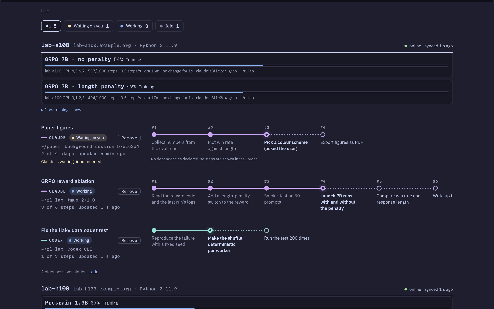
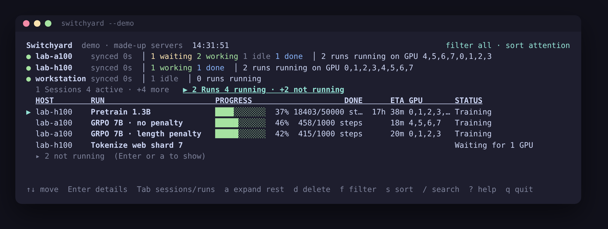
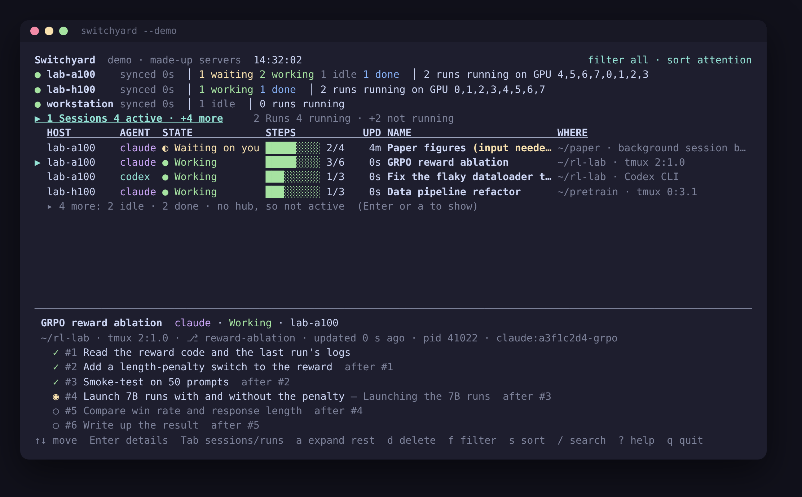

<h1 align="center">🚉 Switchyard</h1>

<p align="center">
  <b>One live board for every Claude Code and Codex session, and every experiment they launched,<br>
  across all your SSH servers. In the browser or in the terminal.</b>
</p>

<p align="center">
  <a href="#try-it-in-30-seconds">Try it</a> ·
  <a href="#set-it-up-for-your-servers">Set up</a> ·
  <a href="#the-terminal-view">Terminal view</a> ·
  <a href="#report-experiment-progress">Report progress</a> ·
  <a href="docs/configuration.md">Configuration</a> ·
  <a href="docs/agents.md">Teach your agents</a>
</p>



You have agents working in tmux on three GPU boxes. One is waiting for an answer, one finished an
hour ago, one launched a 7B training run that is 41% done. Switchyard shows all of that on one
page, live, without you SSH-ing around:

- **Sessions as metro lines.** Each session's own task list (Claude Code's tasks, Codex's
  plan) becomes a line of stops: done, current, still to come. Sessions that are **waiting on
  you** come first, with the reason ("input needed").
- **Experiments as progress bars.** A run reports its own progress with a one-line Python call;
  Switchyard measures the real rate, shows an ETA and the GPUs it holds, and says when it stops
  advancing instead of sitting at a confident percentage.
- **Everything else you'd go looking for:** the full conversation of any session, every task it
  ever had (including ones it deleted), a log of every status change, and your own notes
  ([a tour of the page](docs/web-page.md)).
- **A top-like terminal view** of the same thing, for when you're already in a shell.



## Try it in 30 seconds

Needs Node 18.2+. The demo uses made-up servers, so there's nothing to configure:

```bash
git clone https://github.com/EndlessCG/switchyard.git
cd switchyard
npm install
npm run demo            # the web page, at http://127.0.0.1:3457
npm run demo:terminal   # the terminal view (q quits)
```

## How it works

```
 your laptop                                     each server (nothing installed)
┌──────────────────────────┐  one SSH connection  ┌────────────────────────────────────┐
│ hub (Node)               │ ───────────────────▶ │ python3 - < collector.py           │
│  · page on 127.0.0.1     │ ◀─────────────────── │  reads ~/.claude, ~/.codex,        │
│  · remembers what you    │  JSON lines, every   │  `claude agents`, tmux, and the    │
│    removed, notes, logs  │  2 seconds           │  run records experiments leave     │
└──────────────────────────┘                      └────────────────────────────────────┘
        ▲            ▲
   browser      `switchyard` (terminal view)
```

The hub keeps one SSH connection per server and streams a small Python collector to it over
stdin. **Nothing is installed or left running on the servers, no port is opened, and the hub
only listens on 127.0.0.1.** The collector reads; it never writes on a server. The one
exception is the terminal view's `d` key, which deletes what you select after asking.

## Set it up for your servers

**You need:** Node 18.2+ on the machine that runs the hub (usually your laptop), passwordless
`ssh` to each server (keys or an agent), and Python 3.8+ on each server. `claude` and `codex`
are found on each server automatically, including installs under nvm or `~/.local/bin`.

1. **List your servers** in `~/.config/switchyard/hosts.json`. `ssh` is an alias from your
   `~/.ssh/config`; `null` means this machine.

   ```json
   {
     "hosts": [
       { "name": "gpu-a", "ssh": "gpu-a" },
       { "name": "gpu-b", "ssh": "gpu-b" },
       { "name": "laptop", "ssh": null }
     ]
   }
   ```

2. **Start the hub** and open http://127.0.0.1:3456:

   ```bash
   npm start
   ```

3. **Get the terminal view** as a command (or run `node cli.js` with the same options):

   ```bash
   npm link        # puts `switchyard` on your PATH
   switchyard
   ```

To keep the hub running in the background (launchd on macOS, systemd on Linux), and for every
setting `hosts.json` takes, see **[docs/configuration.md](docs/configuration.md)**.

## The terminal view



`switchyard` opens a live, full-screen view, like `top`. A line per server says what's going on
there; below it, a table of **runs** (it opens on these) or **sessions** (`Tab`). Runs that are
still going are listed; finished ones and ones whose process died fold into one `▸ N not running`
row. `Enter` opens the selected row's details: a session's whole roadmap, scrolled to where it
is, or a run's rate, ETA, GPUs and pid.

| Key | Does |
| --- | --- |
| `↑` `↓` `j` `k` · `PgUp` `PgDn` · `g` `G` | move |
| `Enter` · `Esc` | open / close details (`Enter` on a `▸` row opens it) |
| `Tab` · `1` `2` | sessions / runs |
| `f` · `s` · `/` | filter by state · sort · search names, folders, steps |
| `a` | show / hide the folded rows |
| `d` | delete the selected run or session, after a y/n question saying exactly what will happen |
| `?` · `q` | all keys · quit |

**Where the data comes from:** if a hub is running, `switchyard` reads it, so it shows exactly
what the page shows. If not, it runs the collector itself over SSH (every host in `hosts.json`),
or just on this machine when there's no `hosts.json`, which makes it handy straight on a server.

**What `d` deletes** is always said in the question first, and nothing is a conversation
transcript:

| Selected | `d` then `y` does |
| --- | --- |
| a run | deletes its record file, `<runsDir>/<id>.json`, on its server |
| a Codex session | `codex archive` (undo with `codex unarchive <id>`) |
| a Claude background session | `claude rm`, which refuses when that isn't safe; the conversation is kept |
| an ended Claude session | deletes its task list folder; the conversation is kept |
| a Claude session in a terminal | nothing: it says to quit it there |

`switchyard --once` (or output to a pipe) prints one snapshot instead. `switchyard --help` lists
every option.

## Report experiment progress

An experiment reports its own progress by writing a small JSON file on the machine it runs on,
and Switchyard picks it up on the next poll. The client is one stdlib-only file,
[`clients/switchyard_progress.py`](clients/switchyard_progress.py); copy it next to your code or
put `clients/` on `PYTHONPATH`.

```python
from switchyard_progress import Run

run = Run("grpo-7b", label="GRPO 7B", gpus=[0, 1, 2, 3])
for step in range(1000):
    train_step()
    run.progress(step + 1, 1000, unit="steps", status="Training")
run.done()
```

From a shell script: `python3 switchyard_progress.py --id grpo-7b --done 10 --total 1000 --pid $$`.
The status text is yours; Switchyard shows it and never interprets it. The record format, the
shell and raw-JSON forms, and where records go are in **[docs/runs-api.md](docs/runs-api.md)**.

**Teach your agents to do this for you:** paste the rules in **[docs/agents.md](docs/agents.md)**
into `~/.claude/CLAUDE.md` or `~/.codex/AGENTS.md`, and every session keeps a task list (its
metro line) and every experiment an agent writes reports its own progress.

**Pairs well with [gpuq](https://github.com/EndlessCG/gpuq)**, a GPU lease queue for shared
servers: jobs wait their turn for free cards, and `gpuq status` shows who holds what.

## Privacy and safety

- The hub listens on `127.0.0.1` only. To read it from another machine, forward the port:
  `ssh -L 3456:127.0.0.1:3456 <hub machine>`.
- Nothing is installed on servers, and session data travels only over your own SSH connections.
  The page itself loads its fonts from Google Fonts, and the Board view loads two pinned,
  integrity-checked scripts from jsDelivr; nothing is sent to them.
- The collector only reads. Notes, the removed-sessions list and the logs stay on the hub's
  machine (`~/.local/state/switchyard/`).
- Deleting is only in the terminal view, one item at a time, after a question that names it.

## Troubleshooting

| You see | Fix |
| --- | --- |
| A server is **offline** | `ssh <alias> true` must work without a prompt: connect the VPN, load your key into the agent. |
| A server shows **error** with a line of text, like a welcome banner | Its `~/.bashrc` prints even in non-interactive shells; print only when `$-` contains `i`. |
| "claude command wasn't found" on a server | Set its path in `hosts.json`: `"claude": "/home/you/.local/bin/claude"`. Same for `codex`. |
| A session you know about isn't on the page | The page shows sessions that are running or had activity since the hub started; the rest are counted as hidden. **Add sessions** lists them. |
| A run never leaves the list | It has no `pid`, so Switchyard can't tell that it ended. Call `run.done()`, or pass `--pid`. |

## Development

```bash
npm test     # Node tests + the collector's pytest suite (needs python3 with pytest)
```

The code is small and has no build step: `hub/` (Node: SSH links, state, HTTP API), `collector/`
(one Python file sent to servers), `public/` (the page: plain JS and SVG), `cli/` (the terminal
view), `clients/` (the progress reporter).

## Credits

Switchyard started as a fork of [claude-task-viewer](https://github.com/L1AD/claude-task-viewer)
by L1AD (MIT); its Kanban board is still there under **Board**. Switchyard adds servers, Codex,
the metro-line roadmaps, run progress and the terminal view. MIT licensed, see [LICENSE](LICENSE).
