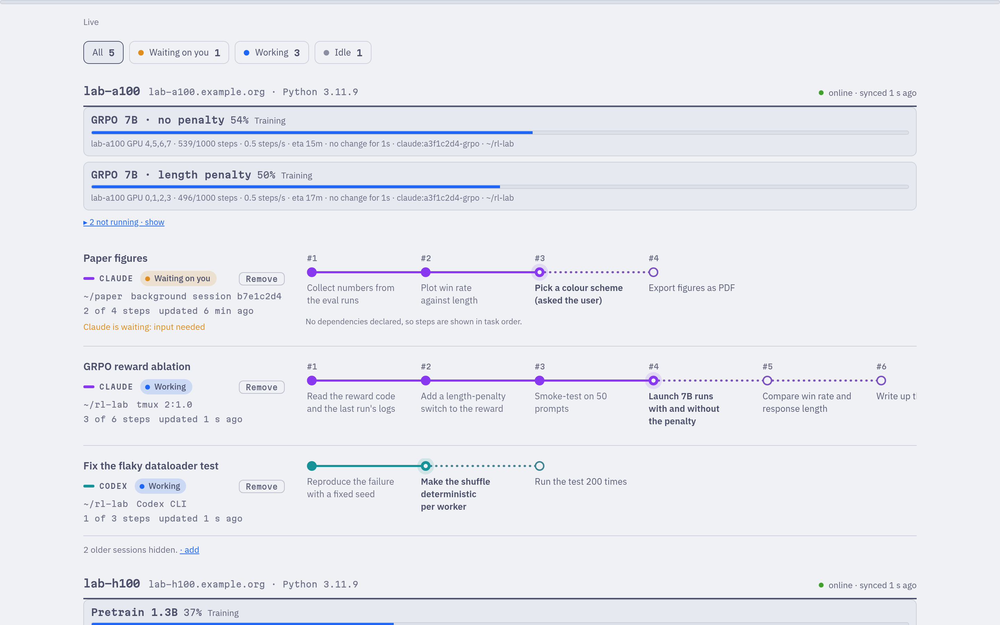

# Reading the web page

**Sessions.** **Lines** shows each session as a line of stops, **Cards** as a grid. Claude lines
are mauve and Codex lines teal. A filled stop is done, the ringed stop is the current step, and
hollow stops on a dotted track are still to come. Claude steps that depend on each other branch
and merge.

**States.** **Working**, **Waiting on you** (idle with unfinished steps, or Claude Code itself
says it's waiting, with the reason, such as "input needed"), **Done** (idle, every step
finished), **Idle**, **Error**, **Stopped** (the session ended). The chips at the top filter by
state.

**Which sessions appear.** A session appears once it's actually in use: a Claude session that's
running right now, or any session with activity since the hub first started. The rest are
counted under each server ("2 older sessions hidden"). **Remove** hides a session (with Undo)
until its next activity; **Add sessions** lists the hidden ones, and **Add** keeps one on the
page until you remove it.

**Runs** sit above a server's sessions: a progress bar per experiment, with its GPUs, its own
status text, the measured rate and ETA, and how long since it last advanced. A run with nothing to
count yet (waiting for GPUs, say) is a status-only row. Finished runs and runs whose process died
fold into "N not running · show".

**A session's panel** (click its name) has four tabs:

- **Roadmap**: every step with its description and dependencies.
- **Conversation**: the whole Claude Code or Codex conversation, streamed live as the agent
  writes its log; tool calls are folded to one line, thinking is hidden.
- **Task history**: every task the session ever had, including ones the agent deleted (struck
  through), with each status it went through and when.
- **Notes**: your own notes. They're kept by the hub on your machine, never sent to the server or
  shown to the agent; a session with a note shows its first line on the page.

**Status changes** (top bar) lists every state change the hub has seen, newest first: a session
starting or stopping work, beginning to wait on you, failing, appearing, or disappearing. It's
recorded while the hub runs and kept across restarts.

**Board** opens the original Kanban and timeline view of Claude task lists, from
claude-task-viewer.

**A server shows offline or error?** See the troubleshooting table in the [README](../README.md#troubleshooting).
